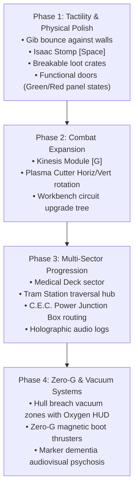

# Proposal 002: USG Ishimura World Expansion, Sector Progression & Long-Term Roadmap

- **Status**: Proposed
- **Author**: Antigravity & Engineering Team
- **Date**: 2026-11-01
- **Target**: `dead-space` Prototype Architecture & Content Pipeline

---

## 1. Executive Summary & Creative Vision

The `dead-space` web prototype has successfully validated the most intricate mechanical foundations of survival horror: **procedural limb severing with localized hit registration, 100% diegetic player UI (spine health bar, circular stasis dial, weapon-mounted holographic ammo), modular Necromorph variants (Slasher, Exploder, Leaper) with crawling fallbacks, dynamic lighting, and stasis temporal dilation.**

To evolve this technical demo into a compelling, full-fledged survival horror experience on the web, this proposal outlines an architectural roadmap covering **environmental atmosphere, systemic power routing, iconic player abilities (Kinesis, Stomp, Plasma Cutter rotation), multi-sector level progression via the Ishimura Tram, and psychological Marker dementia.**

---

## 2. Atmospheric & Environmental World Building

### 2.1 Volumetric Environmental Hazards & Vacuum Decompression Zones
- **Steam & Chemical Vents**: Ruptured coolant and exhaust pipes venting thick volumetric steam across corridors. Isaac's flashlight casts dramatic volumetric god rays through the mist, reducing visibility to under 3 meters and concealing incoming Necromorphs until audio cues betray their presence.
- **Atmospheric Breaches (Vacuum Zones)**:
  - Select hull corridors breached into the cold vacuum of space.
  - **Muffled Diegetic Audio**: Sound transmission ceases; all external audio is muted through a steep low-pass filter (~300 Hz cutoff in Web Audio API), leaving only the resonant vibrations inside Isaac’s suit: labored breathing, pressurized suit vents, and heavy footsteps on metal.
  - **Diegetic Oxygen Counter**: A holographic countdown timer (60–90 seconds) projected above Isaac's spinal pack. Failure to reach an airlock or refill station before oxygen depletes results in progressive suffocation damage and death.

---

### 2.2 Systemic C.E.C. Circuit Breakers (Power Rerouting Dilemmas)
- Move away from automatic doors towards systemic resource trade-offs inspired by Dead Space:
  - High-voltage C.E.C. Power Junction Boxes installed at crossroads.
  - Each junction has **1 Power Cell** to allocate across **3 critical systems**:
    - `[CORRIDOR LIGHTING]`: Full visibility, but locks blast doors and shuts down oxygen scrubbers.
    - `[SECURITY BLAST DOORS]`: Unlocks passage to supply rooms and progress routes, but cuts all lighting in the sector down to pitch-black darkness.
    - `[OXYGEN / LIFE SUPPORT]`: Maintains breathable atmosphere in breached sections at the cost of opening maintenance vents through which Necromorphs ambush.
- Forces active tactical decision-making where illumination is a precious commodity traded against accessibility and safety.

---

### 2.3 The Red Marker Psychosis & Audio-Visual Dementia
- As Isaac progresses deeper into the ship, proximity to the alien Marker induces deteriorating mental stability:
  - **Directional 3D Audio Whispers**: Subtle, deranged whispers (*"Make us whole"*, *"Turn it off"*) panned stereophonically to simulate hallucinations originating directly behind the player's head.
  - **Peripheral Hallucinations**: Shadowy Necromorph silhouettes and human figures darting across intersections in peripheral vision that evaporate when illuminated by direct flashlight beam.
  - **Unitology Inscriptions**: Glowing bioluminescent glyphs and scrawled blood messages across bulkhead walls that react to Isaac's proximity.

---

## 3. Expanded Core Mechanics (Completing Isaac's Arsenal)

```
        ┌────────────────────────────────────────────────────────┐
        │                 DEAD SPACE CORE COMBAT                 │
        └───────────────────────────┬────────────────────────────┘
                                    │
            ┌───────────────────────┼───────────────────────┐
            ▼                       ▼                       ▼
   [Tactical Dismemberment]    [Kinesis Module]         [The Stomp]
    Target limbs, arms &        Launch severed claws     Crush supply crates &
    weak points to disable      & explosive canisters    finish off crawling foes
```

### 3.1 Kinesis Module (Gravity Tether System)
- **Input**: Aim (`Right Mouse Button`) + `[G]` key.
- **Behavior**:
  - Emits a shimmering blue gravitational tether from Isaac’s left gauntlet.
  - **Object Acquisition**: Magnetically pulls lightweight physical objects (severed Slasher scythe-arms, explosive red fuel canisters, metal pipes, crates) and suspends them steadily in front of Isaac.
  - **Impale & Projectile Launch**: Pressing `Left Mouse Button` launches the held object with massive kinetic velocity.
  - **Tactical Impact**: Severed necromorph blades can pin enemies directly to bulkheads, conserving valuable plasma cutter ammunition. Explosive canisters detonate on impact, creating secondary AoE blasts.

---

### 3.2 Isaac Clarke's Stomp (`[Space]` Key)
- **Input**: Dedicated `[Space]` key when not aiming.
- **Behavior**:
  - Triggers Isaac’s signature heavy armored boot stomp accompanied by vocal grunts of exertion and a metallic floor impact thud.
  - **Loot Unboxing**: Shatters wooden and C.E.C. plastic supply crates scattered across rooms, spilling plasma cells, medkits, and stasis batteries onto the floor.
  - **Execution**: Instantly crushes fallen or legless crawling Necromorphs, preventing them from lunging or ambushing Isaac from behind.

---

### 3.3 Plasma Cutter Dual Mode (Horizontal / Vertical Emitter Rotation)
- **Input**: Aim (`Right Mouse Button`) + `[Space]` or `[Middle Mouse Button]`.
- **Behavior**:
  - Mechanically rotates the 3 laser diodes by 90 degrees with an authentic pneumatic servo sound.
  - **Horizontal Mode**: Ideal for severing legs (crawlers) and decapitating heads.
  - **Vertical Mode**: Ideal for lopping off outstretched arms, claws, and Leaper tails.

---

### 3.4 C.E.C. Bench (Workbench) & Power Node Upgrade Tree
- Dedicated wall-mounted Workbench units featuring an interactive holographic circuit grid.
- Players spend collectible **Power Nodes** to unlock branching upgrades:
  - **Plasma Cutter**: Damage output, reload speed, magazine capacity, and secondary burn damage.
  - **RIG Suit**: Maximum Health (+25 HP increments), kinetic armor plating, stasis capacity, and air tank volume.

---

## 4. USG Ishimura Sector Hierarchy & Level Design

Rather than a single isolated procedural sector, structure the ship into **interconnected thematic decks accessible via the central Ishimura Tram Station**:

| Sector Deck | Visual & Environmental Theme | Primary Threats | Mission Objective |
| :--- | :--- | :--- | :--- |
| **Sector 1: Flight Deck & Hangar** | Cold industrial hangars, flickering amber warning beacons, hanging power cables, claustrophobic maintenance access tunnels. | Standard Slashers, duct-crawling ambushers. | Restore emergency power to the Tram transit station and acquire the Plasma Cutter. |
| **Sector 2: Medical Deck & Morgue** | Blood-smeared clinical tiles, shattered containment tubes, morgue lockers, quarantine blast doors. | Exploders (swollen volatile bodies), fast ceiling-crawling Leapers. | Synthesize thermite to burn through a barricaded quarantine seal. |
| **Sector 3: Hydroponics & Greenhouses** | Overgrown alien corruption, pulsing yellow biomass webbing over metal walls, thick spore haze. | Camouflaged Lurkers, bio-mass pod hazards, atmospheric toxicity. | Activate filtration towers to cleanse the deck's air supply. |
| **Sector 4: Engineering & Reactor Core** | Roaring industrial machinery, molten thermal conduits, crushing hazards, elevated catwalks. | Multi-wave quarantine lockdowns, heavy armored Necromorphs. | Realign fuel injectors and stabilize orbital decay before planetary impact. |

---

## 5. Diegetic Narrative & Objective Pipeline

### 5.1 Holographic Video Communications
- In-game video feed projected from Isaac's RIG into open 3D space:
  - Video feed displaying static-laden holographic broadcasts from **Kendra Daniels** (systems analysis) and **Zach Hammond** (tactical orders).
  - Isaac remains controllable and vulnerable while transmissions play in real time, preserving unbroken tension.

### 5.2 Audio Logs & Text Transcripts
- Handheld personal data devices (PDAs) left by Ishimura crew members:
  - Detail the initial outbreak, escalating crew dementia, mass religious suicides, and the mysterious recovery of the Marker on planet Aegis VII.
  - Diegetic audio plays through the suit speakers with spatialized reverb.

---

## 6. Phased Implementation Roadmap



### Phase 1: Physical Tactility & Environmental Feedback (Immediate)
1. **Wall Collision for GibParts**: Add lightweight AABB reflection against `ShipLevel.colliders` so severed limbs bounce and clatter against walls instead of clipping outside the geometry.
2. **Isaac's Stomp (`[Space]`)**: Implement heavy melee stomp animation, audio impact, and floor trace.
3. **Breakable Loot Crates**: Place C.E.C. supply crates in corridors that shatter upon being stomped or shot, revealing ammo and medkits.
4. **Interactive Doors**: Add security panels on door frames indicating status: **Green** (unlocked / opens on approach) vs. **Red** (locked / requires objective or power).

### Phase 2: Combat Expansion
1. **Kinesis Module (`[G]`)**: Implement gravity tether ray, object pickup, physics holding position, and ballistic impale launches.
2. **Plasma Cutter Reticle Rotation**: Add horizontal/vertical toggle for tactical severing angles.
3. **Workbench & Power Nodes**: Implement node pickup and the circuit-board upgrade terminal.

### Phase 3: Multi-Sector Progression & Systemic Puzzles
1. **Medical Deck Expansion**: Add morgue tile textures, cryo chambers, and new corridor modules.
2. **Tram System**: Interactive transit car linking Sector 1 to Sector 2.
3. **Circuit Breakers**: Functional power junction boxes that toggle lighting vs. door power.
4. **Holographic Audio Transmissions**: Diegetic video calls with static and subtitles.

### Phase 4: Zero-G & Atmospheric Decompression
1. **Vacuum Rooms**: Exterior hull breaches, muffled Web Audio, and oxygen depletion gauge.
2. **Zero-G Navigation**: Disabling floor gravity, allowing Isaac to leap across bulkheads and walls with magnetic boots.
3. **Marker Hallucinations**: Whispered audio layers and phantom silhouettes.
